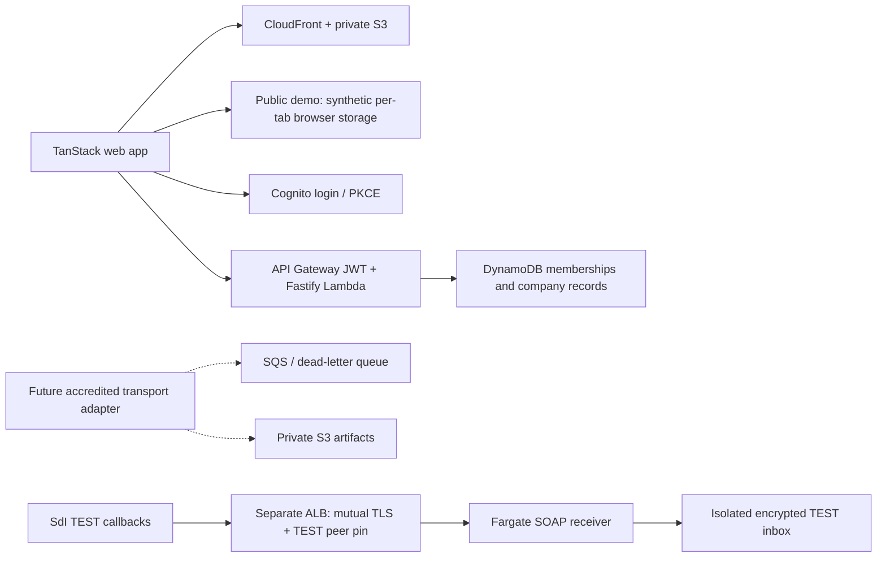

# OpenFatture

A TypeScript workspace for Italian invoicing: a TanStack React application, a Fastify API, shared validated contracts and AWS CDK infrastructure. Supports a shared multi-company deployment or one self-hosted company through a server-enforced feature flag.

Application: **https://openfatture.com/**. The public demo needs no account; company workspaces use invited Cognito users. See the [deployment record](docs/deployment.md) for deployment status and domain setup.

## Try the product

Choose **Prova la demo** on the home page, or open **[/demo](https://openfatture.com/demo)**. Create a sample client, prepare a document, download draft XML and record an incasso. Each browser tab has its own synthetic workspace, stored in `sessionStorage`; it survives reloads until the browser clears that session. **Ripristina demo** restores the examples and **Esci dalla demo** returns to the public page. Browser tabs duplicated by the browser can initially copy session storage, then evolve separately. Use fictional data only.

The public demo runs entirely in the browser. Its data operations never call the production API or fiscal providers. It is separate from both a real company account and an SdI test environment. Open **[/login](https://openfatture.com/login)** for company access, first-login instructions and password recovery guidance. A successful login without assigned company membership shows onboarding instructions.

The interface uses shadcn/ui, the supplied neutral/purple theme, square corners and a persistent light/dark preference. Documents and tables retain keyboard navigation and forms use accessible labels and modal focus management.

**Start with the [self-hosting and SdI guide](docs/self-hosting-and-sdi.md)** for plain-language instructions on the Agenzia portals, requesting your own recipient code, using an existing provider and enabling mass services.

**In italiano:** [Guida rapida per le aziende](docs/guida-rapida-aziende.md).

## Run locally

Use Node.js 22.12+ and npm 10+. No AWS credentials or external invoicing account is needed for the local demo.

```sh
npm ci
npm run dev
```

Open **http://localhost:5173**. The API listens on **http://127.0.0.1:3001**. The explicitly labeled demo has fictional company data and persists changes in `apps/api/.data/openfatture.json`. Stop the server and remove that local file to reset the demo.

Create customers and draft documents, search/filter invoices, prepare them locally, download draft XML, record payments and save mass-service request drafts. The dashboard updates from API records. API errors are displayed; the browser does not substitute sample data for a failed request.

The local API demo binds to loopback and is limited to localhost. The separate browser-only demo is available at `/demo` when `features.publicDemo` is enabled. Production always uses Cognito for API access; it never falls back to anonymous API authentication.

## Choose one company or a shared application

Multi-tenant mode defaults to `true`. The API checks the verified user's stored membership for every company selection. Merely sending a company header does not grant access.

For one local demo company, run:

```sh
MULTI_TENANT=false SELF_HOSTED_COMPANY_ID=company_demo npm run dev
```

Also set `features.multiTenant` to `false` in `apps/web/public/config.json` to hide company switching. For AWS, CDK generates matching frontend/backend settings:

```sh
AWS_PROFILE=dlt npm run infra:synth -- -c stage=dev
AWS_PROFILE=dlt npm run infra:synth -- -c stage=dev -c multiTenant=false -c selfHostedCompanyId=company_acme
```

Build the web assets before synthesizing. A single-company deployment still requires authentication and membership in its pinned company. Changing the flag does not migrate or delete data.

## Deploy on AWS

The reviewed target is the `dlt` AWS profile in **eu-south-1 (Milan)**. The new application uses its own resources and does not depend on the existing DLT MySQL database or VPC.



Read the [AWS review](docs/aws-review.md) for the initial account inspection, the [deployment record](docs/deployment.md) for the live production service, and the [deployment runbook](infra/README.md) for deployment and operations. The repository's CI checks and synthesizes without deploying.

```sh
npm run check
AWS_PROFILE=dlt AWS_REGION=eu-south-1 npm run infra:synth -- -c stage=dev
AWS_PROFILE=dlt AWS_REGION=eu-south-1 npm run infra:diff -- -c stage=dev
# After reviewing bootstrap permissions and the diff:
AWS_PROFILE=dlt AWS_REGION=eu-south-1 npm run infra:deploy -- -c stage=dev
```

The deployment outputs the web URL, API URL, user pool and table identifiers. Invite a Cognito user and provision an empty company linked to that user's `sub` using the [API onboarding instructions](apps/api/README.md). Do not seed production with demonstration invoice data.

Enable the public browser demo with `-c publicDemo=true` on **synth, diff and deploy**. It defaults to disabled for self-hosted deployments and does not alter API authorization. Keep the flag on subsequent deployments of the public OpenFatture instance.

## Commands and layout

| Command | Purpose |
| --- | --- |
| `npm run dev` | Start API and web app together |
| `npm run check` | Type-check, run unit/API/infra tests and build |
| `npm run test:e2e` | Browser workflow tests; install Chromium with `npx playwright install chromium` first |
| `npm run sdi:check` | Offline official-source checks and integration readiness report; never sends fiscal data |
| `npm run sdi:certificates -- --help` | Read-only certificate, key-match, CA-chain and TEST-peer verification; no network requests |
| `npm run test:integration` | Offline XML/SMTS tests; Python 3.10+, `scripts/sdi-requirements.txt` and npm dependencies required for full coverage |
| `npm run infra:synth -- -c stage=dev` | Generate CloudFormation locally |
| `npm run infra:diff -- -c stage=dev` | Review target-account changes |
| `npm run provision -- --company-file ./company.json --subject <sub>` | Create initial production company/membership; requires `TABLE_NAME` and AWS credentials |
| `npm run membership -- --action grant --company-id <id> --subject <sub> --role viewer` | Grant a user access to an existing company; use `--action revoke` without `--role` to revoke |

| Directory | Contents |
| --- | --- |
| `apps/web` | Vite, React, TanStack Router, Query and Table; Italian UI |
| `apps/api` | Fastify service, Lambda adapter, local/DynamoDB persistence, authorization |
| `apps/sdi-gateway` | TEST-only SOAP callback receiver, pinned official WSDL/XSD and isolated durable inbox |
| `packages/domain` | Zod request contracts and fixed-point money calculations |
| `infra` | Retained data/identity stack, application stack and optional SdI TEST gateway |
| `docs` | Company onboarding, integration research and AWS review |
| `docs/references/sdicoop` | Official v1.5 protocol schemas/WSDL and source checksums |

## Integration readiness

This release provides a working preparation and management application. **It does not submit or receive fiscal invoices, sign SMTS requests or provide compliant conservation.** “Ready” means prepared locally. Exported invoice XML is a draft and is not certified against the current FatturaPA rules. Mass jobs remain `awaiting_configuration`.

The [SdI integration testing checklist](docs/sdi-integration-testing.md) separates offline tests, provider simulations and accredited-channel tests, and lists the exact blockers for each. The [product research](docs/product-research.md) maps delivered features to the Agenzia and Fatture in Cloud documentation. The optional server-side Fatture in Cloud adapter only reads authorized company information. Public OAuth onboarding, provider writes and webhook synchronization are not implemented.

The separate [SdI TEST receiver](apps/sdi-gateway/README.md) supports the eight receiving/notification SOAP operations, persists quarantined attachments before acknowledging, and checks the incoming TEST peer through mutual TLS and an exact certificate pin. It does not send invoices or import received files into company records. Its optional AWS stack has separate certificate/trust prerequisites and recurring costs; follow the [gateway runbook](infra/SDI-TEST-GATEWAY.md). The application's certificate and endpoint status is visible only to administrators of the configured operator tenant. The public demo never receives that metadata.

Production storage currently keeps each company's records in a versioned aggregate with a 350 KB application ceiling. Conditional writes prevent lost updates. Split storage into per-record items before higher-volume operation. Local JSON storage supports one API process. VAT handling is limited to the supported domestic rates; see the API documentation for fiscal scope.
