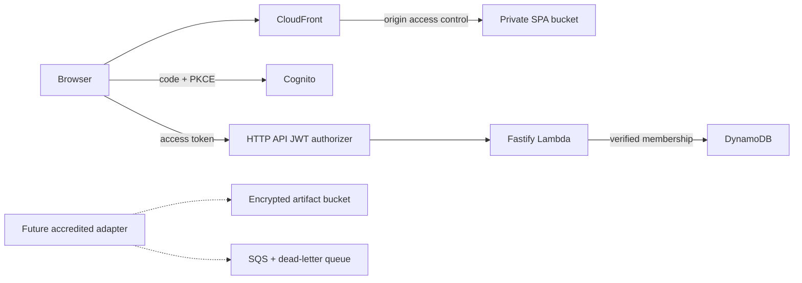

# DLT AWS review

Reviewed 12 November 2026 using local Hermes configuration, existing DLT infrastructure handoff documents, and bounded read-only AWS CLI queries. No resource, credential, DNS, existing application or account setting was changed. Secret values and private keys were not read or copied into this repository.

## Context actually inspected

- `/root/.hermes/profiles/dlt/config.yaml` and `profile.yaml`: DLT profile; workspace is empty and supplies no infrastructure project.
- `/root/.hermes/profiles/dltinfra/config.yaml` and `profile.yaml`: DLT infrastructure profile. The configured AWS MCP proxy permits the `dlt` and `robytour` CLI profiles. No callable AWS MCP tool was available to this agent, so inventory used the AWS CLI.
- `/root/.aws/config`: `dlt` uses `credential_process` and defaults to `eu-south-1`; `robytour` defaults to `eu-west-1`. The interactive DLT alternative is `dlt-login`.
- `/root/DLT/AWS_INFRA_REVIEW_20261019/ORIENTATION_HANDOFF.md` and `CLONE_FORK_ORIENTATION.md`: October notes distinguish Robytour's original platform from DLT's Milan fork. Existing platform code includes an Aruba invoicing integration; its credentials and contracts are not reused here.
- `/root/DLT/AWS_ROLESANYWHERE_20261030/README.md`: describes the office workstation certificate-based access and source-IP restriction. No certificate or key material was read.

The requested `dltinfra app` was resolved to the installed Hermes `dltinfra` profile and its AWS tooling; no separate checked-out `dltinfra` application or IaC project was found in these profile workspaces. A bounded search of DLT's source tree found the infrastructure review and clone records above, rather than a reusable CDK project.

## Observed live state

The `dlt` profile successfully called STS on 12 November, returning the DLT-owned account `509581811464` and the assumed `DltUbuntu01RolesAnywhere` role. The account ID is an identifier, not an authentication secret; it appears in the explicit bootstrap command so the operator can verify the target.

Milan (`eu-south-1`) inventory returned:

| Area | Observation |
| --- | --- |
| Network | Non-default `dlt-prod` VPC, CIDR `10.20.0.0/16`, plus the default VPC. |
| Compute | Four running EC2 instances: DLT frontend, second frontend, control, and clone helper. |
| Database | Two MySQL RDS instances in `dlt-prod`; primary reports `PubliclyAccessible=false`, replica reports `true`. The flag alone does not establish network reachability; security groups were outside this review. |
| Serverless | No Lambda functions; no ECS clusters returned. |
| CloudFormation | No stacks with `CREATE_COMPLETE` or `UPDATE_COMPLETE`; an explicit lookup confirmed `CDKToolkit` does not exist in Milan. Other stack statuses were not enumerated. |
| CDN | One enabled CloudFront distribution returned globally, with no aliases. No modification or reuse proposed. |

This is a targeted compatibility and deployment review, not a full audit of policies, backups, networking, quotas, spend, or every Region. The successful STS and list calls do not prove that all bootstrap/deployment permissions or service quotas are sufficient.

## Deployment design

The new repository defines an independent serverless application using AWS CDK TypeScript in Milan:

This avoids changes to production EC2, RDS, VPC, internal DNS, or Robytour resources. No VPC/NAT is required for the current application because its dependencies are managed public AWS service endpoints. Later read-only import from DLT MySQL should use an explicitly reviewed network/data contract rather than sharing the booking database by default.

Data and identities live in a separate retained stack; production enables stack termination protection. DynamoDB uses on-demand capacity, customer-managed encryption, point-in-time recovery and deletion protection. Artifact S3 storage is private, KMS encrypted and versioned. The reserved queues have encryption, TLS-only policies, retention and redrive settings but no transport consumer. They establish infrastructure seams, not a working SdI channel.

Cognito denies self-registration and supplies a public client with authorization code flow, PKCE in the SPA, token revocation, and refresh-token rotation. The API authorizer requires `openid` scope so ID tokens alone are insufficient; the backend verifies access tokens and reads membership records keyed by verified user subject. A selected company header is only a selector. It never grants access. The multi-tenant feature flag can restrict a self-hosted installation to one provisioned company while retaining all membership and role checks.

The generated deployment includes the built web app and runtime `config.json` so Cognito callback origins, the frontend and API agree without committing cloud identifiers into frontend source. Offline CI synthesizes against a placeholder account and makes no AWS writes. Actual deployment uses the reviewed `dlt` profile after bootstrap and a diff.

## Remaining operational work

The account is not CDK-bootstrapped in Milan. No bootstrap or deployment was performed. Review the generated template and bootstrap role policy before creating resources. Deployment commands and first-user onboarding are in [infra/README.md](../infra/README.md).

Live SdICoop requires accreditation, credentials/certificates, provider/authority conformance tests, transport implementation, reconciliation, and fiscal review described elsewhere in the repository. No credential from DLT's existing Aruba integration was transferred. Define alert destinations, restore drills, production operator access and a company onboarding process before live invoicing. Keep invoices and customer data in the selected EU Region; CloudFront distributes static application assets globally; business records remain in the regional API and data stores.

Official references used to verify implementation choices: [CDK CloudFront origin access control](https://docs.aws.amazon.com/cdk/api/v2/docs/aws-cdk-lib.aws_cloudfront_origins.S3BucketOrigin.html), [HTTP API JWT authorizers and token scopes](https://docs.aws.amazon.com/apigateway/latest/developerguide/http-api-jwt-authorizer.html), [Cognito client configuration](https://docs.aws.amazon.com/cdk/api/v2/docs/aws-cdk-lib.aws_cognito.UserPoolClient.html), [Cognito authorization code PKCE](https://docs.aws.amazon.com/cognito/latest/developerguide/using-pkce-in-authorization-code.html), [CDK bootstrap](https://docs.aws.amazon.com/cdk/v2/guide/bootstrapping.html).
